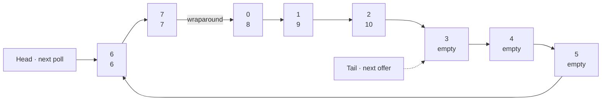

# Ring Buffer

A small Java 17 implementation of a fixed-capacity FIFO ring buffer for `long` values. The buffer holds up to eight values and reuses its storage as values are removed.

## Features

- FIFO `offer` and `poll` operations
- Fixed capacity of 8 values
- Rejects offers when full without overwriting existing values
- Throws `IllegalStateException` when polling an empty buffer
- Tracks the current number of stored values with `size()`

## How it works

The buffer uses a fixed set of eight slots. The read and write positions advance through the slots and wrap back to slot 0 at the end. This example shows five queued values: polling begins at slot 6, and the next offer goes into slot 3.



Following the slot arrows from the head gives the FIFO order (`6`, `7`, `8`, `9`, `10`). The tail marks where the next accepted offer will be written.

## Requirements

- Java 17 or later
- Maven

## Usage

Add the source to your project or build this repository with Maven. The class is in the `org.finance` package:

`offer(long)` returns `false` when all eight slots are occupied. Check `size()` before calling `poll()` if the buffer may be empty; `poll()` throws `IllegalStateException` in that case.

This implementation is not thread-safe.

## Build and test

Run the test suite:

```sh
mvn test
```

Build the package:

```sh
mvn package
```
